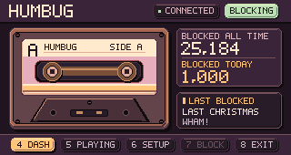
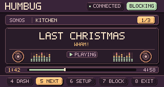
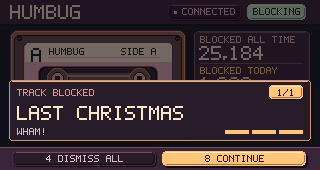
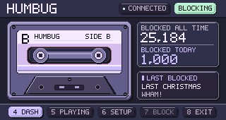
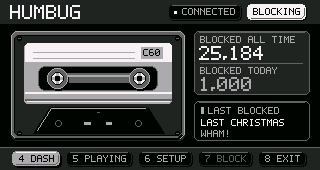
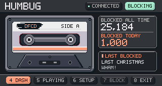
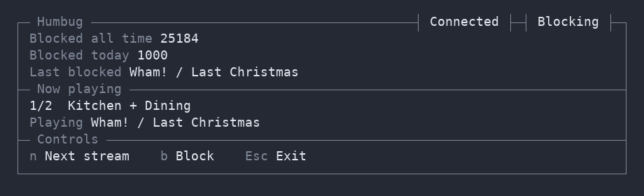
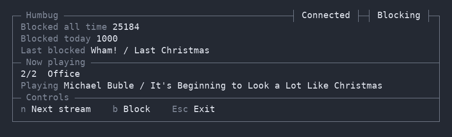

#  Humbug

_Keep unwanted tracks off your office or home Sonos speakers and Google Cast receivers._

**Don't want to get Whammed?** Humbug is a pocket-sized CardputerZero bouncer for Sonos speakers and Google Cast receivers.

Humbug monitors the track metadata on connected players and checks it against the enabled blocklists. When a song matches, it tells the player to skip to the next track.

The built-in Christmas blocklist comes with [a bunch of filters for tracks, keywords and artists](assets/christmas.blocklist). That's a lot of opportunities to dodge the office festive playlist.

> **Being a humbug is not just for Christmas.** <br/> Block unwanted tracks and artists from your work playlists all year round with a custom blocklist, or bring down the *whammer* on a song with the press of a button.

Humbug runs natively on **CardputerZero**, with a Linux CLI sharing the same C++ backend. No Sonos or Spotify account is required.

This grew out of the **Blunt Blocker**, a project of mine from a decade ago designed to stop people in the office from playing James Blunt on the work Sonos. Some battles are worth fighting all year round.

> **Support this project** <br/> Help support the work that goes into creating and maintaining my projects and sponsor me via [GitHub Sponsors](https://github.com/sponsors/workeffortwaste/).

## Contents

- [ Humbug](#-humbug)
  - [Contents](#contents)
  - [Screenshots](#screenshots)
    - [Screens](#screens)
    - [Themes](#themes)
    - [CLI screenshots](#cli-screenshots)
  - [Features](#features)
      - [Keep Christmas at bay](#keep-christmas-at-bay)
      - [Make it personal](#make-it-personal)
      - [Keep an eye on the office](#keep-an-eye-on-the-office)
      - [Keep things from escalating](#keep-things-from-escalating)
  - [CardputerZero build and package](#cardputerzero-build-and-package)
    - [Download and install](#download-and-install)
    - [Build it yourself](#build-it-yourself)
  - [No Cardputer, no problem](#no-cardputer-no-problem)
    - [CLI](#cli)
    - [CLI options](#cli-options)
  - [Controls](#controls)
  - [Environment variables](#environment-variables)
  - [Networking](#networking)
  - [Blocklist and failure behaviour](#blocklist-and-failure-behaviour)
  - [Attribution](#attribution)
  - [Sponsors](#sponsors)
  - [Author](#author)
  - [License](#license)

## Screenshots


### Screens

<table>
  <tr>
    <td align="center"><a href="assets/preview/dashboard-side-a.png"></a><br>Dashboard</td>
    <td align="center"><a href="assets/preview/playing-sonos.png"></a><br>Now Playing</td>
  </tr>
  <tr>
    <td align="center"><a href="assets/preview/blocked.png"></a><br>Blocked</td>
  </tr>
</table>

### Themes

Humbug comes with four distinct themes, accessible from the `setup` menu.

<table>
  <tr>
    <td align="center"><a href="assets/preview/dashboard-side-a.png"></a><br>Side A</td>
    <td align="center"><a href="assets/preview/dashboard-side-b.png"></a><br>Side B</td>
  </tr>
  <tr>
    <td align="center"><a href="assets/preview/dashboard-blank-tape.png"></a><br>Blank Tape</td>
    <td align="center"><a href="assets/preview/dashboard-bootleg.png"></a><br>Bootleg</td>
  </tr>
</table>

### CLI screenshots

[](assets/images/cli-1.png)
[](assets/images/cli-2.png)

## Features

#### Keep Christmas at bay

The bundled Christmas blocklist is on by default, but you can switch it off whenever you've had enough of being a Grinch.

#### Make it personal

Add your own track and artist rules, or block the song that's playing now.

#### Keep an eye on the office

See what's playing and how many songs Humbug has blocked on the main dashboard.

#### Keep things from escalating

If the same blocked song comes straight back after a skip, Humbug quietly stops playback; clearly there's a mad lad in control of the music who can't be reasoned with. Alternatively, the song might just be on repeat, and it's best to nip that in the bud to stop a potential resonance cascade.

Otherwise, after 10 consecutive automatic skips without an allowed track, Humbug stops playback on the next blocked song. If escalating situations are your thing, you can turn off **Auto-stop after 10 skips** in the Setup menu.

## CardputerZero build and package

### Download and install

When available, download the CardputerZero `.deb` from the [release assets](https://github.com/workeffortwaste/humbug/releases), or install Humbug from the CardputerZero store using code **HBUG**.

To install the downloaded package manually, copy it to the device and run the following command, replacing `<version>` with the package version:

```sh
sudo apt install --no-install-recommends './Humbug_<version>_rev1-cpz_arm64.deb'
```

### Build it yourself

Install an aarch64 Linux cross-toolchain and Debian packaging tools on the host:

```sh
sudo apt install crossbuild-essential-arm64 dpkg-dev
cmake --workflow --preset cp0-cross-package
```

The workflow configures the cross-build, builds the release application and creates the Debian package. 

The package maintainer is configured for this project; override `APP_MAINTAINER` at configure time if building under a different maintainer.

The resulting package is `dist/Humbug_<version>_rev1-cpz_arm64.deb`. Copy it to the device and install it as shown above.

It installs `/usr/bin/humbug`, `/etc/humbug.conf`, `/usr/share/humbug/` assets and an APPLaunch launcher entry.

The CLI is not included in the CardputerZero package.

## No Cardputer, no problem

You can run Humbug from a Linux or macOS terminal instead.

### CLI

> **Requirements** <br/> CMake **3.31+**, a C++20 compiler, Ninja, Git and OpenSSL development headers (`libssl-dev` on Debian/Ubuntu).

On Debian/Ubuntu Linux, install the build prerequisites:

```sh
sudo apt install build-essential cmake ninja-build git libssl-dev
```

Check that the installed CMake is at least 3.31, then build and run:

```sh
cmake --preset core
cmake --build --preset core
ctest --preset core
./build/core/humbug-cli
```

On macOS, with Xcode Command Line Tools and Homebrew installed:

```sh
brew install cmake ninja openssl@3
cmake -S . -B build/macos -G Ninja -DHUMBUG_BUILD_GUI=OFF \
  -DOPENSSL_ROOT_DIR="$(brew --prefix openssl@3)"
cmake --build build/macos
ctest --test-dir build/macos --output-on-failure
./build/macos/humbug-cli
```

### CLI options

The CLI accepts the following options. Defaults can also be changed using the [environment variables](#environment-variables) below.

| CLI argument | Description | Type | Default value |
| --- | --- | --- | --- |
| `-h`, `--help` | Show help and exit. | Flag | |
| `--no-christmas` | Disable the built-in Christmas blocklist; custom rules remain enabled. | Flag | Christmas blocking enabled |
| `--config FILE` | Use an existing readable custom blocklist. It must also be writable to save new rules. | Path | Default custom blocklist |
| `--device HTTP_URL` | Supply a Sonos device description URL instead of SSDP discovery. Can be repeated; URLs must use HTTP and a numeric IPv4 address. Does not disable Cast discovery. | URL | SSDP discovery |
| `--listen IPV4` | Set the local IPv4 address advertised for Sonos callbacks. | IPv4 address | Selected from the route to each speaker |
| `--port PORT` | Set the callback TCP port; `0` chooses an available port. | Integer | `0` |

## Controls

| Key | Action |
| --- | --- |
| `4` | Open Dashboard; dismiss Deck Dock alerts or cancel reset |
| `5` | Open Now Playing; press again to cycle through streams and wrap to the first |
| `6` | Open Setup |
| `7` | Block displayed song when available; skip or stop |
| `8` | Exit during normal navigation; continue to the next Deck Dock alert or confirm reset |
| Hold `ESC` | Exit; short `ESC` cancels reset or clears Deck Dock alerts |
| `Up` / `Down` or `F` / `X` | Select a Setup row |
| `Left` / `Right` or `Z` / `C` | Change the palette on the Theme row |
| `Enter` | Toggle an Options switch, open or cancel reset, or advance the Deck Dock alert |

## Environment variables

Both frontends recognise these environment variables:

| Variable | Purpose |
| --- | --- |
| `HUMBUG_BLOCKLIST` | Explicit path to an existing writable blocklist |
| `HUMBUG_CHRISTMAS_BLOCKING` | Built-in Christmas blocking: `1` (default) or `0` (off) |
| `HUMBUG_DEVICE` | One description URL, bypassing SSDP |
| `HUMBUG_SONOS_DISABLED` | Set to `1` to disable Sonos discovery and monitoring |
| `HUMBUG_CAST_DISABLED` | Set to `1` to disable Cast discovery and monitoring |
| `HUMBUG_CAST_DEVICE` | One numeric `IPv4:port` Cast endpoint, bypassing Cast mDNS |
| `HUMBUG_CAST_INTERFACE` | Local numeric IPv4 address for Cast mDNS, when the default route is unsuitable |
| `HUMBUG_LISTEN_ADDRESS` | Local LAN IPv4 address advertised for callbacks |
| `HUMBUG_LISTEN_PORT` | Callback TCP port; `0` chooses an available port |

## Networking

Humbug and your speakers need to be able to reach each other on your local network. Humbug discovers Sonos speakers and Cast receivers automatically.

> [!IMPORTANT]
> Sonos speakers must be able to connect back to Humbug for playback updates. A firewall, VPN or network isolation can prevent this even if the speakers are discovered.

If speakers aren't found or updates aren't working, check your firewall, VPN and network settings. The [environment variables](#environment-variables) let you specify a device or network address when automatic discovery or the default connection doesn't work. Specifying a Sonos device bypasses discovery, but the speaker still needs to connect back to Humbug.

Humbug joins an existing Cast session rather than starting one.

## Blocklist and failure behaviour

The custom blocklist is normally stored at `$HOME/.config/humbug/custom.blocklist`.

You can create it manually, or Humbug will create it automatically on the first manual block action. Note that Humbug will require a restart if edits are made to the file while the app is running.

The built-in blocklist and the custom list use the same rules and matching behavior:

```text
artist:Example Artist
track:Unwanted Song
keyword:unwanted phrase
```

| Rule | Matches | Matching behaviour |
| --- | --- | --- |
| `artist:` | Full artist credit | Ignores case, punctuation and accents |
| `track:` | Full title, including common recording suffixes | Ignores case, punctuation and accents |
| `keyword:` | Whole words or phrases in titles and albums | Ignores case, punctuation and accents |
| `exact:` | Artist and title together | Case-sensitive exact match |

The block button adds `exact:ARTIST<TAB>TITLE`. These entries match the **exact, case-sensitive artist and title together**.

## Attribution

- Based on the MIT-licensed [CardputerZero template](https://github.com/CardputerZero/Template) at commit `477fa6d217b683e3084c361a757f03dc8ca9f753`, retaining its LVGL platform, asset, theme, input and reactive helpers. See [LICENSE](LICENSE).
- TinyXML2 10.0.0 is fetched from its upstream repository and statically linked under its zlib licence.
- utf8proc provides Unicode normalization for matching and display; its MIT and Unicode notices are included in the device package.
- Cast uses OpenSSL, nlohmann/json (MIT) and the public-domain mDNS library by Mattias Jansson.

## Sponsors

If you find Humbug useful, please consider supporting my projects through [GitHub Sponsors](https://github.com/sponsors/workeffortwaste/).

## Author

Chris Johnson - [defaced.dev](https://defaced.dev) - [@defaced.dev](https://bsky.app/profile/defaced.dev) (Bluesky)

## License
This project is licensed under the MIT License.